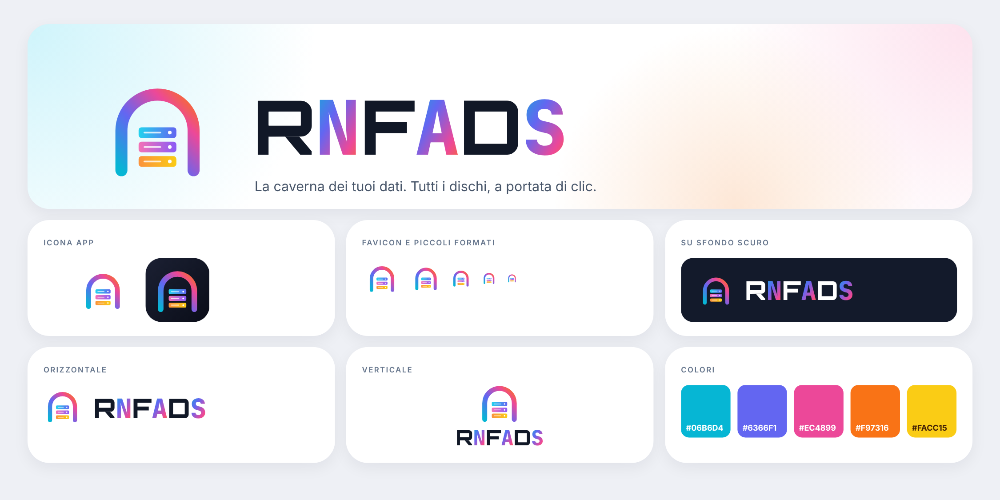
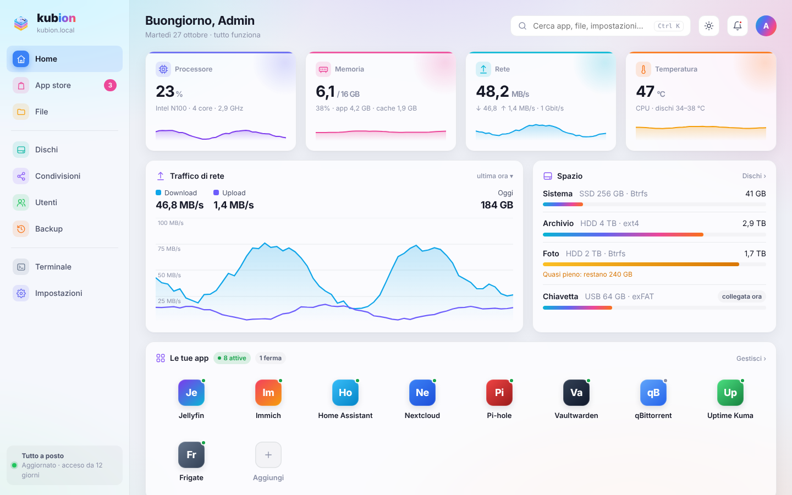

# RNFADS

**Italiano** · [English](#english)

RNFADS è un sistema operativo per NAS basato su Ubuntu, con un'interfaccia web propria in italiano, inglese, spagnolo e
tedesco. Si installa su un PC (anche vecchio) e lo trasforma in un NAS per la casa: cartelle condivise, app, backup,
servizi cloud e accesso da fuori casa, tutto dal browser.

## Cosa fa

- **File e condivisioni**: gestione file dal browser, condivisioni SMB e NFS con permessi per utente, cartelle anche sul
  disco di sistema.
- **Dischi**: stato SMART, formattazione, montaggio, avvisi su spazio e temperatura.
- **App**: App store con cataloghi della comunità (Big Bear, LinuxServer, CoolStore, Runtipi) e Docker Hub; installazione,
  aggiornamento e ritorno alla versione di prima.
- **Backup** cifrati con restic, anche verso i servizi cloud.
- **Servizi cloud** dall'interfaccia: Google Drive, OneDrive, Dropbox, Box, MEGA, WebDAV/Nextcloud, S3, Backblaze B2,
  SFTP, FTP (con rclone).
- **Rete**: indirizzo automatico o fisso, DNS, Wi-Fi, con ritorno automatico se qualcosa va storto.
- **Accesso remoto** con Tailscale o ZeroTier; HTTPS con certificato di casa.
- **Schermo del NAS**: l'interfaccia sul monitor collegato al NAS.
- **Notifiche** (Telegram, ntfy, email, webhook) e integrazione con **Home Assistant**.
- **Aggiornamenti** firmati (Ed25519), con snapshot e ritorno automatico.
- Installer in 4 lingue con scelta di tastiera e fuso orario; avvio BIOS e UEFI (Secure Boot).

## Scaricare e installare

1. Scarica la ISO dalla pagina [Releases](../../releases) e controlla l'SHA256.
2. Scrivila su una chiavetta USB (es. con Rufus, balenaEtcher o Ventoy).
3. Avvia il PC dalla chiavetta e segui l'installer: lingua, tastiera, fuso orario, disco di sistema, nome del NAS, utente.
4. Dopo il riavvio apri dal browser di un altro dispositivo `http://<nome-del-nas>.local`.

Requisiti: PC x86-64, 4 GB di RAM (8 consigliati), disco di sistema da almeno 32 GB (SSD consigliato).

## Costruire la ISO

La ISO si costruisce da questo repository con `kit/build.sh` su Ubuntu 26.04 (o in un chroot/contenitore), da root.
Dettagli in [kit/README.md](kit/README.md) e in [docs/SPEC.md](docs/SPEC.md).

## Licenza e marchi

Il codice di RNFADS è distribuito con licenza **GPL-3.0** (vedi [LICENSE](LICENSE)). La ISO contiene programmi di Ubuntu e
di altri progetti, ognuno con la propria licenza: l'elenco e i sorgenti sono pubblicati insieme a ogni Release.

I nomi e i loghi di app, servizi e cataloghi citati appartengono ai rispettivi proprietari; RNFADS non è affiliato a
loro. Ubuntu è un marchio di Canonical Ltd.

---

## English

RNFADS is a NAS operating system based on Ubuntu, with its own web interface in Italian, English, Spanish and German. It
installs on a regular PC and turns it into a home NAS: shared folders, apps, backups, cloud services and remote access,
all from the browser.

**Features**: file manager and SMB/NFS shares, disk health, app store (community catalogues and Docker Hub), encrypted
backups with restic, cloud services via rclone, network settings with automatic rollback, Tailscale/ZeroTier remote
access, local screen interface, notifications, Home Assistant integration, signed updates with automatic rollback, and a
4-language installer (BIOS and UEFI with Secure Boot).

**Install**: download the ISO from [Releases](../../releases), check the SHA256, write it to a USB stick, boot from it and
follow the installer. Then open `http://<nas-name>.local` from another device.

**License**: GPL-3.0. Third-party components keep their own licenses; the list and sources are published with each
release. Names and logos of third-party apps and services belong to their owners; RNFADS is not affiliated with them.
